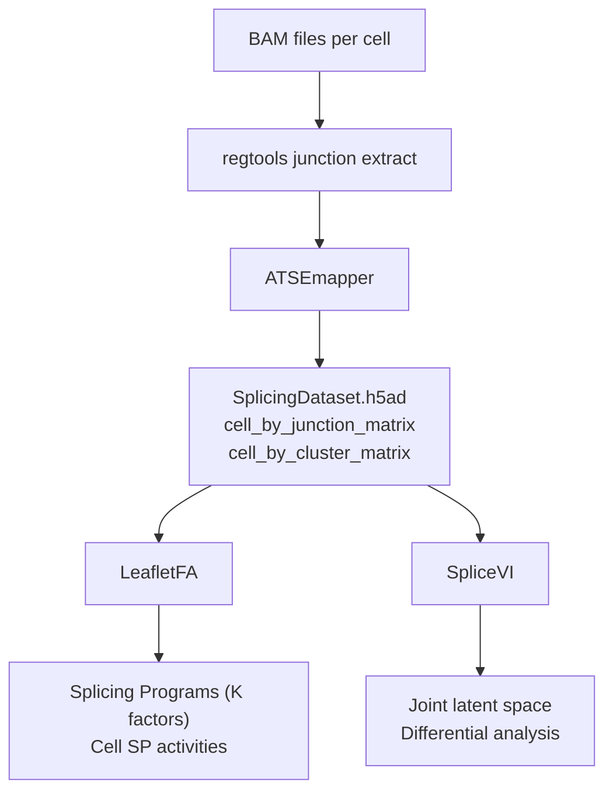

# SpliceVI

SpliceVI is a multimodal variational autoencoder that jointly models **gene expression** and **alternative splicing** (junction usage / PSI) from single-cell data. It learns a joint low-dimensional representation of cells from both modalities, imputes junction usage, and tests for differential splicing and expression between groups of cells. In sparse atlases it can find splicing differences that pseudobulk tests have too few reads to assess.

## Ecosystem overview

SpliceVI and LeafletFA read the same splicing format, **SplicingDataset**, which ATSEmapper builds from junction reads.



| Tool | Role | Repo | Docs |
|------|------|------|------|
| **ATSEmapper** | BAM files → SplicingDataset | [daklab/ATSEmapper](https://github.com/daklab/ATSEmapper) | |
| **LeafletFA** | Beta-Dirichlet factor model for splicing programs | [daklab/LeafletFA](https://github.com/daklab/LeafletFA) | [docs](https://daklab.github.io/LeafletFA) |
| **SpliceVI** | Multimodal VAE (splicing + gene expression) | [daklab/SpliceVI](https://github.com/daklab/SpliceVI) | this site |

ATSEmapper groups the junctions found by regtools into ATSEs and writes the read counts in this format.

## Quick install

```bash
git clone https://github.com/daklab/SpliceVI.git
cd SpliceVI
pip install -e .
```

## Minimal example

```python
import mudata
from splicevi import SPLICEVI

mdata = mudata.read_h5mu("train_data.h5mu")

SPLICEVI.setup_mudata(mdata, batch_key="mouse.id")   # layer names default to the expected layout

model = SPLICEVI(mdata)   # defaults = the paper's settings
model.train()

latent = model.get_latent_representation()   # (cells × n_latent) joint latent space
psi    = model.get_normalized_splicing_DM()  # (cells × junctions) imputed PSI values
```

See [SpliceVI model](models/splicevi.md) for the full parameter reference and [SpliceVI MuData Object](data-format.md) for the expected input structure.

## Citation

If you use SpliceVI, please cite the following paper.

> Vaidyanathan S, Isaev K, Zweig A, Knowles DA. *Robust Integration of Sparse Single-Cell Alternative Splicing and Gene Expression Data with SpliceVI*. bioRxiv 2025. https://doi.org/10.1101/2025.11.26.690853
